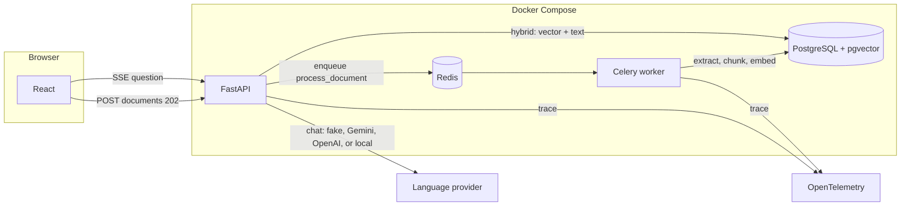

# Architecture

The adjuster uploads documents. The API stores them and answers with a job id. A worker chunks and indexes them. Questions do not wait for that worker: they read only the chunks already active for that claim, cite the evidence, and refuse to answer when the evidence is not enough.

## Ingest

1. `POST /api/claims/{claim}/documents` checks type and size, computes the sha256, and writes the file on the shared volume.
2. If those bytes are already active on the claim, nothing is enqueued.
3. If the name already existed with different bytes, the previous version becomes `active = false`. Its chunks are kept for citations already delivered and drop out of search.
4. The worker sets `extracting`, `chunking`, `embedding`, `indexing`, and finally `ready`, or `failed` with the reason. The UI shows those statuses in English.
5. Chunks are replaced in one transaction. A retry that stops halfway does not publish partial pieces.

## Query

1. Embed the question with the same provider that indexed the claim.
2. Top 20 by cosine and top 20 by English `tsvector`, filtered by `claim_id` and `active`.
3. Reciprocal Rank Fusion with k = 60.
4. If the top result does not share content words with the question, the answer is a refusal. The model is not called.
5. If there is evidence, citations go out over SSE before the text. The summary is then validated with Pydantic, with a single repair attempt. The chat shows "Preparing the summary…" from the first answer token until that card arrives.

## Language providers

Chat and embeddings are chosen separately.

| Setting | Values |
| --- | --- |
| `LLM_PROVIDER` | `fake`, `gemini`, `openai`, `local` |
| `EMBEDDING_PROVIDER` | `fake`, `gemini` |

`fake` is deterministic and needs no key. `gemini` calls Gemini. `openai` calls `api.openai.com`. `local` calls an OpenAI-compatible server on the host, reached from Compose at `host.docker.internal`. Gemini and OpenAI time out at 20 seconds. The local server times out at 180 seconds. `LLM_FALLBACK` may name a second real chat provider, and only before the first token. It is never `fake`. Embeddings have no fallback: a different embedding model means a new volume and a new upload. The column is 384 dimensions.

## Traces

Each stage (upload, extraction, embedding, retrieval, LLM) is a span. The attributes are ids, latency, chunk count, and estimated tokens and cost. Document text is not copied onto the trace.

## Integration test

`tests/test_integration_pgvector.py` starts `pgvector/pgvector:pg16` with testcontainers. It is the same engine as the Compose `postgres` service, but the test does not depend on someone having started Compose first.
